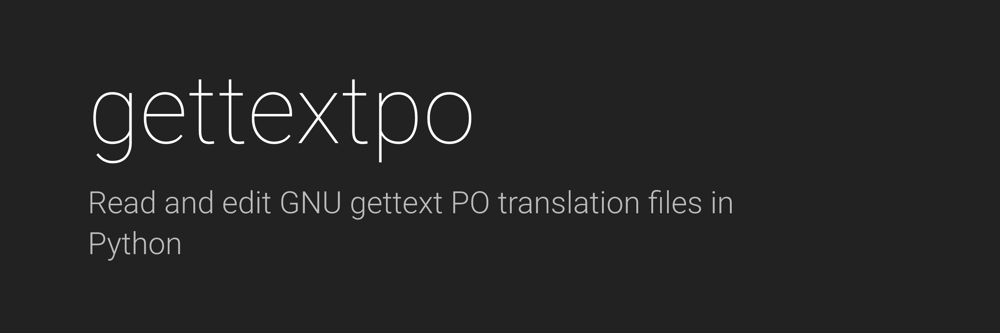

<p align="center"></p>
<p align="center"><strong>Read and edit GNU gettext PO translation files in Python</strong></p>
<p align="center"><a href="https://github.com/conao3/python-gettextpo/actions/workflows/CI.yml"></a> <a href="https://github.com/conao3/python-gettextpo/releases"></a> <a href="LICENSE"></a> <a href="https://github.com/conao3/python-gettextpo/stargazers"></a></p>
<p align="center"><a href="#installation">Installation</a> | <a href="#quick-start">Quick Start</a> | <a href="#api-reference">API Reference</a> | <a href="#license">License</a></p>
<h1>gettextpo</h1>

Python bindings for the GNU gettext PO file library, built with Rust and PyO3.

## Overview

gettextpo provides direct access to libgettextpo, the GNU gettext library for parsing and manipulating PO (Portable Object) translation files. This package enables you to read, write, and programmatically edit PO files with full access to message metadata, comments, and validation.

## Installation

```bash
pip install gettextpo
```

### Build from source

This package requires the gettext development libraries and Rust toolchain.

```bash
# Install dependencies (Debian/Ubuntu)
apt-get install libgettextpo-dev

# Install dependencies (macOS)
brew install gettext

# Build and install
pip install maturin
maturin develop
```

## Quick Start

```python
from gettextpo.lib import PoFile, PoHeader

# Read an existing PO file
po = PoFile.read("messages.po")

# Or load from a string
po = PoFile.load("""
msgid "Hello"
msgstr "Bonjour"
""")

# Access domains and headers
for domain in po.domains():
    header = po.domain_header(domain)
    po_header = PoHeader(header)
    print(f"Content-Type: {po_header['Content-Type']}")

# Iterate over messages
for domain in po.domains():
    for message in po.messages(domain):
        # Access message properties via the low-level API
        pass
```

## Features

- Read and write PO files
- Access and modify message headers
- Iterate over translation messages
- Support for plural forms
- Handle translator and extracted comments
- Track file positions for messages
- Manage obsolete and fuzzy message flags
- Format string validation

## API Reference

### PoFile

- `PoFile.create()` - Create a new empty PO file
- `PoFile.read(filename)` - Read a PO file from disk
- `PoFile.load(contents)` - Load a PO file from a string
- `po.domains()` - List all domains in the file
- `po.domain_header(domain)` - Get the header for a domain
- `po.messages(domain)` - Iterate over messages in a domain

### PoHeader

- `PoHeader(header)` - Create a header wrapper
- `header[field]` - Get a header field value
- `header[field] = value` - Set a header field value
- `header.render()` - Get the header as a string

## Requirements

- Python 3.12 or later
- libgettextpo (gettext development library)

## Release

Run the Release workflow from `master`:

```bash
gh workflow run release.yml --ref master -f version_bump=patch
```

The run bumps the version in `Cargo.toml`, `Cargo.lock` and `pyproject.toml`, pushes the version commit to `master` together with the annotated tag `v<version>`, builds the wheels and the sdist from that tag, publishes them to PyPI with trusted publishing (environment `pypi`), and creates the GitHub Release.

## License

GPL-3.0-or-later
